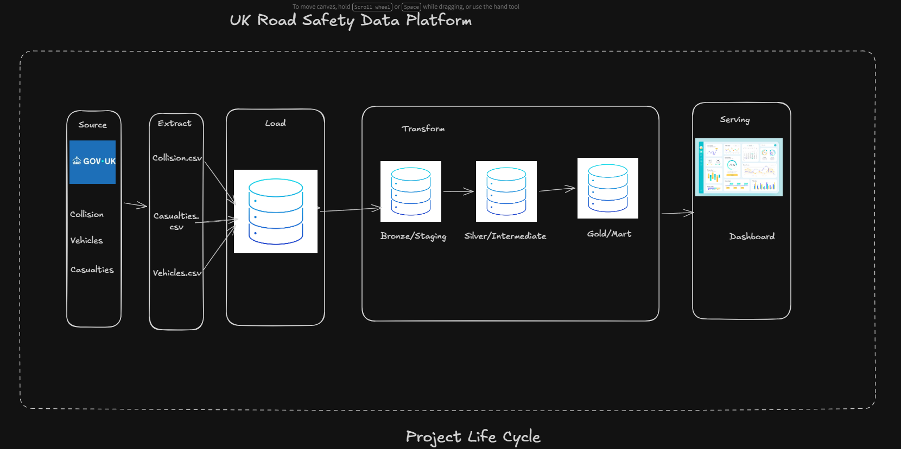

## UK Road Safety Data Platform

### Project Overview
The UK Road Safety Data Platform aims to build a data platform that collects, processes and analyses road safety data across the United Kingdom.

The project will use publicly available data from the Department for Transport (DfT), including collision, vehicle and casualty records, to develop a reliable and accessible source of information for road safety analysis

### Project Objectives
The main objectives are to:
- Automate the collection and ingestion of road safety data from official sources.
- Clean, transform and organise the data for analysis.
- Develop a structured data platform to support reliable reporting and analysis.
- Build interactive dashboards to explore road safety trends, patterns and insights.
- Make it easier to understand collision trends, casualty outcomes and the factors associated with road incidents.

### Project Scope
The initial phase will focus on DfT's road safety data, covering collsions, vehicles and casualties over the last 5 years.
The project will progressively introduce automated data ingestion, data transformation, quality checks, analytical data models and visual reporting.

### Expected Outcome
The intended outcome is an automated and well documented data platform supported by interactive dashboards. It will provide a foundation for exploring UK road safety data, identifying trends and generating insights that could support better understanding and decision-making.

### Project Development
This repository will evolve as the project progresses. Further documentations will be added to explain the architecture, technologies, data sources, pipeline processes, data models and analytical outputs.

### Collaboators
- Abdulmalik Adesokan - Data Engineer
- Henry Chiegbu - BI Developer